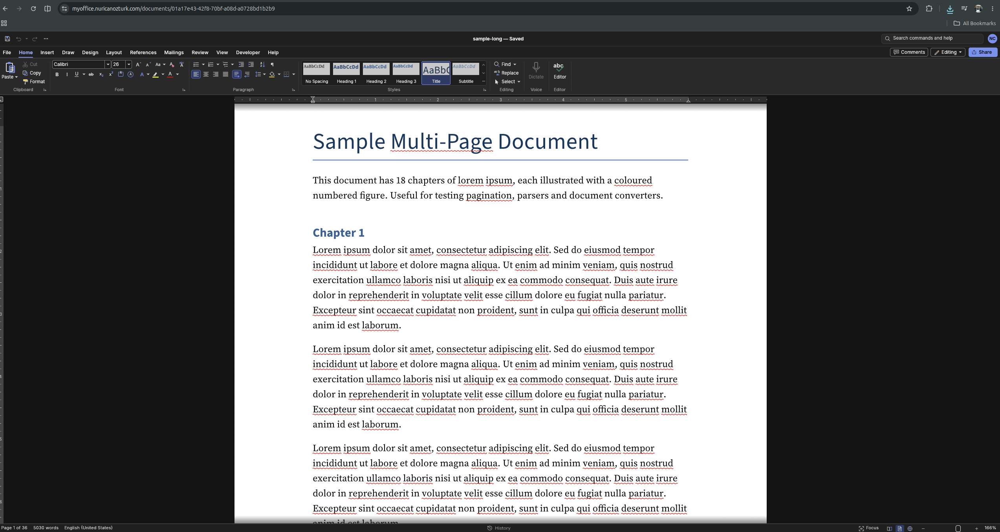
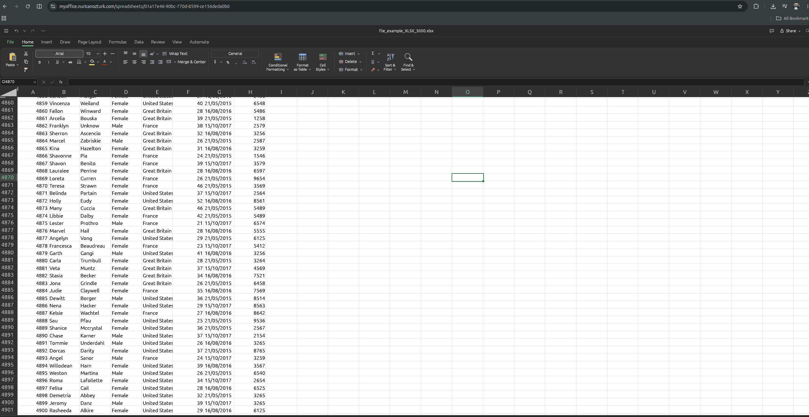
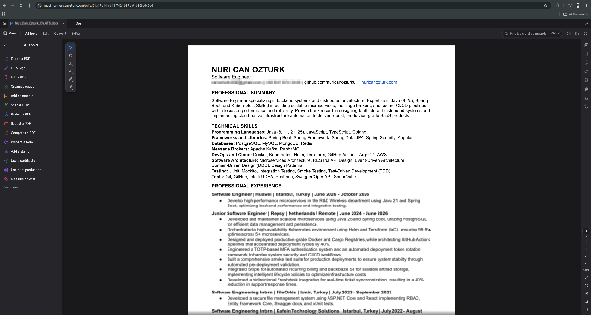
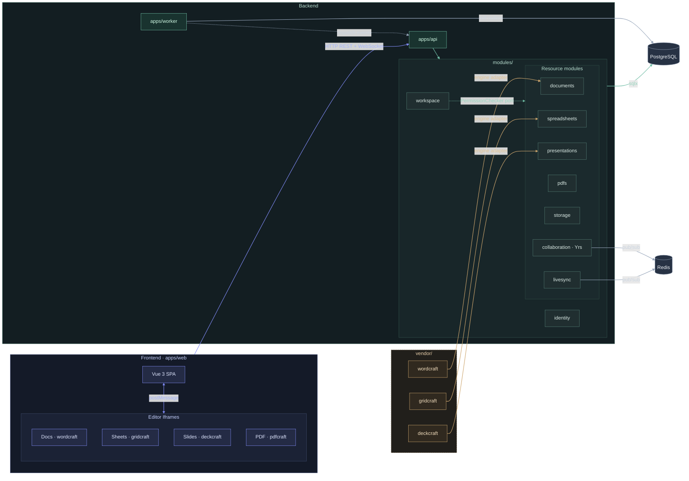

# Office Suite

A browser-based collaborative office suite — Docs, Sheets, Slides and PDF viewer — built with Rust + Axum on the backend and Vue 3 on the frontend.

## Features

- **Docs** — rich-text document editing, `.docx` import/export
- **Sheets** — spreadsheet with full formula engine, `.xlsx` import/export
- **Slides** — presentation editor, `.pptx` import/export
- **PDF** — PDF upload and view (pdfcraft iframe)
- Real-time autosave; CRDT multi-user sync (`collaboration` module, **currently wired to Docs only**)
- Sharing with viewer / commenter / editor roles; non-shared files are never visible to other users
- JWT authentication with rotating refresh tokens (HttpOnly cookie)
- GDPR data export endpoint

---

## Screenshots

<table>
<tr>
<td width="33%"></td>
<td width="33%"></td>
<td width="33%"></td>
</tr>
<tr>
<td align="center">Docs — wordcraft</td>
<td align="center">Sheets — gridcraft</td>
<td align="center">PDF — pdfcraft</td>
</tr>
</table>

---

## Architecture



### Isolation rules

| Rule | Detail |
|---|---|
| Module ↔ module | Only via `*-contracts` crate (port traits + events). Never import another module's `core`. |
| Cross-schema SQL | Forbidden. Each module owns its PostgreSQL schema; no cross-schema JOINs or foreign keys. |
| Consistency | Eventual — outbox pattern. Events written in the same transaction as business data; the in-process event runtime (`apps/api`) dispatches them. |
| Vendor crates | Only `modules/<m>/engine` adapter crates may depend on `vendor/`. Vendor code is never edited. |
| Composition root | All dependency wiring (`Arc<dyn Trait>`) happens in `apps/api` only. |

---

## Codebase Guide

### Backend

#### `apps/api`
HTTP server entry point. Composition root: reads settings, runs migrations, constructs every module, injects port implementations, mounts routes. Also starts the event runtime in-process (`crates/platform::background::EventRuntime`) — outbox relay and Redis broadcast listener run as background tasks inside this binary. There is no separate worker process yet.

#### `crates/shared-kernel`
Pure, I/O-free types used everywhere: `typed_id!` macro (newtype UUID wrappers), `Clock` port, `IdGenerator` port. No `sqlx`, no `axum`, no network.

#### `crates/platform`
Infrastructure helpers shared by all modules: database pool helpers, HTTP extractors (`AuthUser`, `ProblemDetails`), event bus (outbox writer + relay, Redis broadcast), cursor-based pagination, settings parser. Tracing/log setup itself lives in `apps/api`, not here.

#### `crates/merge3`
Pure, deterministic three-way merge over arbitrary sequences (LCS-based). Used by the `DocxMerger`/`XlsxMerger`/`PptxMerger` types in the `documents`/`spreadsheets`/`presentations` engine crates, injected into `storage` via its `PackageMerger` port to reconcile concurrent saves. No I/O, fully tested with property-based tests.

#### `modules/identity`
User accounts, password auth (Argon2id), JWT access tokens, rotating HttpOnly refresh cookies, OIDC/OAuth2 (Google, Microsoft). Publishes `UserRegistered`, `ProfileUpdated`, `UserDeletionScheduled`. Provides `UserDirectory` port consumed by `workspace`.

#### `modules/workspace`
Resource sharing (ACL), permission roles (`Viewer` / `Commenter` / `Editor` / `Owner`). Implements the `PermissionChecker` port consumed by every resource module. Publishes `ResourceShared`, `PermissionRevoked`.

#### `modules/documents`
Metadata only (id, title, owner, timestamps) — document body lives in `storage` as a versioned `.docx` package. CRUD, cursor-based listing, `.docx` import/export (via engine adapter). Provides `DocumentAccess` port, consumed by `collaboration`.

#### `modules/spreadsheets`
Owns its content directly: workbook JSON + version counter in its own schema. CRUD, `.xlsx` import/export (via engine adapter). Formula evaluation runs in the engine adapter (`session.rs`), not the core.

#### `modules/presentations`
Owns its content directly: deck JSON + version counter in its own schema. CRUD, `.pptx` import/export (via engine adapter).

#### `modules/pdfs`
Metadata only (id, title, owner, timestamps) — PDF bytes live in `storage` as a versioned package. No `engine` adapter: the module doesn't parse or render PDFs itself; the pdfcraft iframe does that client-side (see `vendor/` note below).

#### `modules/storage`
Versioned file packages (`.docx`/`.xlsx`/`.pptx`/`.pdf`) stored as byte blobs in PostgreSQL. Handles concurrent-save conflicts via three-way merge (`crates/merge3`). Powers the editor "save" path.

#### `modules/collaboration`
WebSocket endpoint for CRDT document sync using **Yrs** (Rust port of Yjs). Manages awareness (presence/cursor), appends updates to `document_updates`, fans out via Redis pub/sub across API instances. Currently wired to `documents` only (`apps/api/src/main.rs` passes only `documents.access` into it) — Sheets/Slides/PDF don't use CRDT sync yet.

#### `modules/livesync`
Lightweight WebSocket endpoint for cursor presence outside the full CRDT sync (e.g. spreadsheet cell selection). Also uses Redis pub/sub fan-out.

#### `vendor/`
**Unmodified** upstream engine crate trees, each pinned to a specific commit SHA. They have their own nested Cargo workspace and are excluded from workspace lint rules. Never edit files here.

| Directory | Upstream | Provides |
|---|---|---|
| `vendor/wordcraft` | github.com/storytold/wordcraft | `doc`, `docx` — ProseMirror doc model, OOXML import/export |
| `vendor/gridcraft` | github.com/storytold/gridcraft | `calc`, `model`, `xlsx`, `formula` — spreadsheet model, OOXML |
| `vendor/deckcraft` | github.com/storytold/deckcraft | `model`, `pptx` — slide scene model, OOXML |

Each module that uses a vendor crate wraps it behind a thin `modules/<m>/engine` adapter crate. That adapter is the only allowed dependency path into `vendor/`.

**`pdfcraft` is the fourth reference app** (`storytold/pdfcraft`, ADR 0001) but is **not** vendored as a Rust crate yet — no `vendor/pdfcraft`, no `modules/pdfs/engine`. Its *web build* is pinned and embedded like the other three (`scripts/build-embeds.sh`, one commit behind upstream: its latest needs an unpublished `craft-libs` revision), which is why the PDF iframe appears in the architecture diagram above even though `vendor/` itself holds only three crate trees.

#### `xtask`
Cargo task runner (`cargo run -p xtask -- <task>`). Implements:
- `arch` — enforces module boundary rules by parsing `cargo metadata` (no cross-core imports, no sqlx/axum in contracts, etc.)
- `vendor-check` — verifies each `vendor/` directory against its pinned SHA and licence files
- `budget` — checks gzip size budgets on the web build
- `migrate` — applies all module migrations in order

---

### Frontend

#### `apps/web`
Vue 3 SPA (Vite, TypeScript strict). Feature-sliced architecture:

| Directory | Role |
|---|---|
| `app/` | Bootstrap: router, Pinia, vue-i18n, global styles |
| `pages/` | Route-level thin components (composition only) |
| `widgets/` | Multi-feature UI shells (e.g. EditorShell) |
| `features/` | User scenarios (share-document, comment-thread, …) |
| `entities/` | Business types and small entity UI (Document, User, …) |
| `editors/` | `embed` — generic iframe port shared by all four editors (incl. PDF); `collab` — CRDT provider; `docs`/`sheets`/`slides` — per-editor adapters |
| `shared/` | UI kit, http client setup, i18n, utils |

Import direction is strict top-down (`app → pages → widgets → features → entities → shared`). Enforced by ESLint.

#### `packages/api-client`
TypeScript API client generated from `openapi.json` via `openapi-typescript` + `openapi-fetch`. Never hand-edited. Regenerated with `just gen-api`; `just gen-api-check` (a committed test, `committed_spec_is_up_to_date`) catches drift between the Rust handlers and the committed client. No CI pipeline runs this automatically yet — it's a local/pre-push check only.

#### `packages/formula-engine`
The spreadsheet formula engine (`spreadsheets-engine-wasm` crate) compiled to **WASM** via `wasm-bindgen`. Lets the frontend evaluate formulas locally without a round-trip. Built by the `wasm` just recipe, output written to `packages/formula-engine/pkg/`.

---

## Stack

| Layer | Tech |
|---|---|
| Backend | Rust 1.96 (edition 2024), Axum, tokio, sqlx (PostgreSQL), Redis |
| Frontend | Vue 3 + TypeScript, Vite, Pinia, TanStack Query, Tailwind CSS |
| Editors | wordcraft / gridcraft / deckcraft / pdfcraft (embedded iframes, pre-built) |
| Realtime | WebSocket + Yrs (Rust port of Yjs), Redis pub/sub fan-out |
| Auth | Argon2id, JWT access token + rotating refresh cookie |
| Infra | Docker Compose (Postgres, Redis), `just` task runner |

---

## Quick start

### Docker — one command

```sh
docker run -d -p 8080:8080 -v office-data:/data repo.repsy.io/nuricanozturk/myoffice-docker/office:latest
```

Open `http://localhost:8080`. Postgres, Redis, the API and the web app all run inside this one
container; the JWT secret is generated on first start and persisted on the `office-data` volume,
so it survives restarts. No login needed — the image is public.

This is a quick-start convenience, not how the stack is meant to scale or how it's hardened in
production (everything running as one root container vs. the distroless/nonroot API + separate
Postgres/Redis of a real deployment). See `docker/office.Dockerfile`.

### Local development

**Prerequisites:** Rust 1.96 (`rustup`), Node ≥ 24.17, pnpm 12, Docker. `lint`/`typecheck`/`test`/`dev-web` also build a WASM crate — needs the `wasm32-unknown-unknown` target and `wasm-bindgen-cli` 0.2.129 (`rustup target add wasm32-unknown-unknown && cargo install wasm-bindgen-cli --version 0.2.129`).

```sh
# 1. Start the backing services
just dev-infra          # postgres + redis

# 2. Run the API (writes .env on first run with a random JWT secret)
just dev-api            # http://127.0.0.1:8080

# 3. Run the frontend
just dev-web            # http://localhost:5173
```

---

## Development commands

```sh
just fmt            # cargo fmt + prettier
just lint           # clippy + eslint
just typecheck      # cargo check + vue-tsc
just test           # cargo test + vitest
just arch           # dependency boundary tests (xtask arch)
just check          # all of the above + drift checks (run before push)

just db-migrate     # apply migrations
just db-prepare     # regenerate .sqlx cache (needs a live DB)
just gen-api        # regenerate openapi.json + TS client
just vendor-check   # verify vendor/ source SHA and licences (xtask vendor-check)
just budget         # gzip size budget check (xtask budget; requires a web build)
```

---

## Security model

- Every API endpoint requires a valid bearer token; unauthenticated requests get `401`.
- Document / spreadsheet / presentation / PDF content is accessible **only** to the owner and users the owner has explicitly shared the file with.
- The sharing API enforces owner-only write access to share grants; the `Owner` role is never grantable through the share endpoint.
- WebSocket sync and live-sync connections re-check the `PermissionChecker` port on every reconnect and at regular intervals; a `PermissionRevoked` event drops active sessions.
- Passwords are hashed with Argon2id; no plaintext credentials are ever logged or stored.
- Import pipelines (docx/xlsx/pptx) enforce byte-size caps and structural limits (sheets, rows, columns, cells, table nesting depth); the XML parsers used don't support external entities. The formula engine (`gridcraft` `calc`) detects circular references instead of looping.

---

## Environment variables

Copy `.env.example` to `.env` (done automatically by `just dev-api`):

| Variable | Description |
|---|---|
| `DATABASE_URL` | PostgreSQL connection string |
| `JWT_SECRET` | ≥ 32 random bytes; `just dev-api` generates one automatically |
| `API_ADDR` | Bind address (default `127.0.0.1:8080`) |
| `REDIS_URL` | Redis connection string |
| `SQLX_OFFLINE` | `true` compiles queries from the committed `.sqlx` cache |
| `COOKIE_SECURE` | Set `true` when served over HTTPS |
| `CORS_ALLOWED_ORIGINS` | Comma-separated list of allowed browser origins |

---

## Licence

Source code in this repository: **MIT**. Vendored engine crates retain their original upstream licences (see each `vendor/*/LICENSE-*`).
